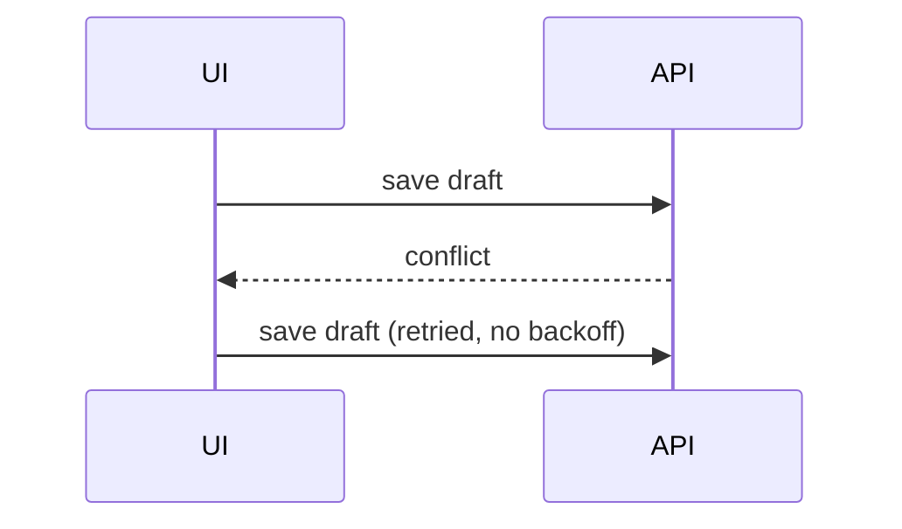

# Shapes

A shape stands in for prose: one sentence captions it, and the shape carries the facts. Pick the smallest shape that carries them, and keep only the load-bearing calls, files, props, states, and boundaries.

- Logic or an algorithm as pseudocode:

```text
on(save)
  if content is unchanged
    return cached result
  write new content
  return fresh result
```

- Runtime control flow as a call tree:

```text
submitForm
  createSession
    persistPrompt
    launchAgent
  navigateToSession
```

- UI structure as a component tree, with the state and module boundaries that matter:

```text
<SessionPage> (apps/example/src/routes/session.tsx)
  useSessionEvents()
  <SessionToolbar>
    <RunSkillButton> (packages/ui)
```

- File responsibility as a shallow file tree:

```text
src/
├── commands/       # parses user actions
├── sessions/       # owns session state
└── transport/      # sends API requests
```

- Component interaction or data flow as Mermaid:

````md
A conflict retries the save straight away, so two tabs editing one draft loop.


````

- A change to a shape that already exists as a `diff` of that shape, a call tree for a call-order change, pseudocode for a control-flow change:

```diff
 on(save)
-  write content
+  if content is unchanged
+    return cached result
+  write new content
+  invalidate cache
```

- The whole block when the reader needs a copyable target: the command to run, the config to paste.
